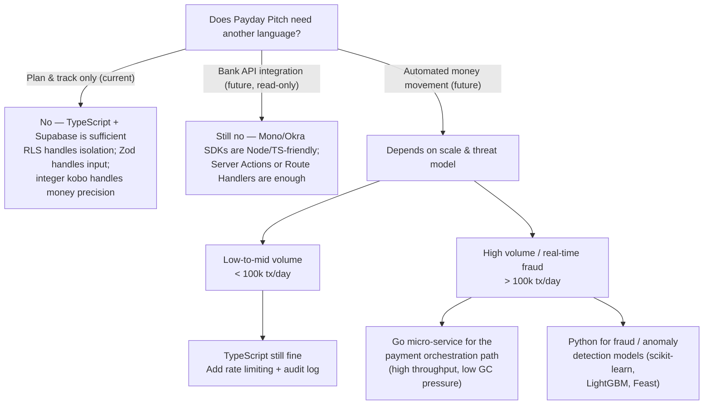
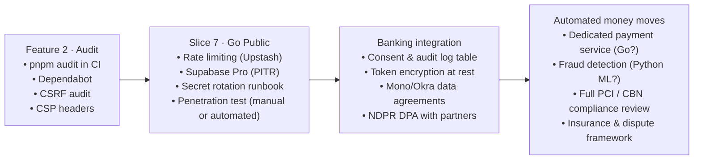

# 0002. Banking integrations & security stack plan

**Date**: 2026-10-21
**Status**: Planning (deferred — no implementation yet)

## Summary

This document records the forward plan for two future capability areas:

1. **Bank API integrations** — connecting Payday Pitch to Nigerian traditional and digital banks so users can sync income data and, eventually, route savings automatically.
2. **Security stack assessment** — an honest evaluation of whether the current TypeScript + Supabase stack is enough for financial-grade trust, and when (if ever) additional languages like Go or Python would add real value.

Neither area has active implementation. Both extend the `## Deferred` section of [`scope.md`](../../scope/scope.md) and should be revisited with `/architect` when they move to active planning.

---

## Part 1 — Bank API Integrations

### What this means for Payday Pitch

The current scope deliberately **plans and tracks only — it never connects to a bank or moves money.** Banking integration is a natural next chapter with two distinct stages:

| Stage | Description | Regulatory bar |
|---|---|---|
| **Read-only sync** | Pull balance & transaction history to auto-fill income streams and spending | Lower — data aggregation only |
| **Automated money moves** | Actually split and route funds to savings pots, wallets, or accounts | High — requires a Payment Service Provider (PSP) licence or partnership |

Both stages are already noted as deferred in `scope.md`. This spec fleshes out *how* they would work and what the landscape looks like.

---

### Nigerian Banking Landscape

#### Traditional Banks (via Open Banking / direct API)

| Bank | API programme | Notes |
|---|---|---|
| GTBank / Guaranty Trust | GTConnect / partner API | Has a developer portal; requires formal partnership |
| Sterling Bank | Sterling OneBank API | Active fintech-friendly programme |
| Access Bank | Access Bank Open Banking | CBN Open Banking framework compliant |
| Zenith Bank | Corporate API (bulk payment, account enquiry) | Mostly corporate; watch for retail Open Banking expansion |
| UBA | UBA Connect API | Pan-African reach; useful later for multi-country |
| First Bank | FirstBank OpenBanking | Available, slower onboarding |

#### Digital / Neo Banks

| Bank | API / integration route | Notes |
|---|---|---|
| **Kuda Bank** | No public API yet; watch for Open Banking compliance | Most likely to open up — tech-native |
| **PiggyVest** | No public API; savings are internal products | Partnership/referral model more realistic than technical integration |
| **PocketApp** | No public API yet | Same parent group as PiggyVest |
| **Moniepoint** | Business API (payments, collections) | Strong for disbursements; retail savings API pending |
| **OPay** | Payment APIs (transfers, wallet) | Aggressive ecosystem; useful for disbursement |
| **Carbon** | Savings & loan APIs (partner access) | Possible savings routing target |
| **Cowrywise** | Investment API (partner programme) | Best fit for the Forwards (investment) position |
| **Stash (ARM)** | API under ARM investment platform | Treasury Bills, Money Market — aligns with Feature 12 |

#### The Aggregator Layer (recommended first step)

Rather than integrating each bank directly, use an **Open Banking aggregator**. These hold the licences, handle consent flows, and normalise the data across banks:

| Provider | Type | Notes |
|---|---|---|
| **Mono** | Account data + direct debit | Best known in Nigeria; real bank connections, CBN licensed |
| **Okra** | Account data + payments | Strong enterprise focus; good for transaction enrichment |
| **Stitch** | Payments + data (SA + NG) | Multi-country; useful when expanding beyond Nigeria |
| **Paystack** | Payments (Stripe-owned) | Not data aggregation, but best-in-class for disbursements |
| **Flutterwave** | Payments + collections | Pan-African; useful for cross-bank sends |

> **Recommended approach:** Start with **Mono** for read-only account sync (income confirmation, spending enrichment) and **Paystack or Flutterwave** for any future money movement. This avoids direct bank integrations until volume justifies individual partnerships.

---

### Proposed additions to `scope.md` `## Deferred`

When the time comes, enrol these three entries under `## Deferred` in `scope.md`:

```
- **Bank data sync (read-only)**: pull verified income and spending automatically
  via an Open Banking aggregator (Mono / Okra). Auto-fills income streams and
  fixed costs; never stores raw credentials. Consent model required.
  · needs a decision · GA

- **Savings routing (automated money moves)**: split and send money to named
  savings pots or external accounts (PiggyVest, Cowrywise, Kuda, etc.) via
  payment rails (Paystack / Flutterwave). Requires PSP partnership or licence,
  a full compliance review, and a fraud/dispute framework before a line of
  code is written. · needs a decision · GA

- **Investment partner referrals**: surface CBN-licensed fund manager products
  (Cowrywise, Stash/ARM, Meristem) in the Forward line guidance feature with
  full disclosure. Revenue share possible; must be clearly disclosed.
  · needs a decision
```

---

### Compliance checkpoints — nothing ships without these

1. **CBN Open Banking Framework** — Nigeria's framework (2021 + 2023 revisions) requires data consent, audit trails, and certified aggregators. Using Mono / Okra means they carry this regulatory burden, not Payday Pitch.
2. **NDPR (Nigeria Data Protection Regulation)** — Financial transaction data is sensitive personal data. Explicit consent, right to erasure, and data processing agreements (DPAs) with every third-party provider are mandatory.
3. **No money movement without a licence or licensed partner** — Payday Pitch cannot hold or route user funds without either its own CBN PSP licence (multi-year, high capital requirement) or a formal agreement with a licensed payment processor that assumes that liability.
4. **PCI-DSS** — If card data ever touches the platform (unlikely given the model), full PCI compliance applies. Design to avoid card data entirely.

---

## Part 2 — Is the Current Stack Enough for Financial-Grade Security?

### Short answer

**Yes — for the current build scope (plan & track only).** The existing architecture has the right foundations. Gaps that matter open up only when real money flows or sensitive data volumes justify them.

---

### What the current stack does well

| Control | How it is implemented | Strength |
|---|---|---|
| Data isolation | Supabase RLS, `auth.uid()` ownership check on every policy, per-table Vitest isolation tests | ✅ Strong — isolation is in the DB, not just app code |
| Input validation | Zod 4 on every Server Action input | ✅ Strong — no raw user data reaches the DB |
| Auth | Supabase Auth (JWT, cookie sessions via `@supabase/ssr`, `getClaims()` — never `getSession()`) | ✅ Good — token verification is local, no session round-trip |
| Secret handling | `SUPABASE_SECRET_KEY` is server-only; no secrets in `NEXT_PUBLIC_` | ✅ Good |
| Money precision | Integer kobo + largest remainder allocation — no floats anywhere in a money path | ✅ Critical — this is the right choice and already implemented |
| Transport | Vercel + Supabase enforce HTTPS everywhere | ✅ Baseline covered |
| Write gate | Every Server Action wrapped by `authedAction()` | ✅ No action bypasses auth |

---

### Gaps to address before any financial transaction touches the system

| Gap | Risk | Recommended fix | When |
|---|---|---|---|
| No rate limiting on Server Actions | Brute-force, enumeration, or denial-of-wallet attacks | Upstash Ratelimit (already a scope candidate) | Before Go Public (Slice 7) |
| No CSRF protection audit | Server Actions have some built-in protection in Next.js 16, but it needs explicit verification | Verify `Origin` header checks in `authedAction()`; document it | Feature 2 / Audit |
| No Content Security Policy (CSP) | XSS could leak auth tokens from the browser | Strict CSP headers in `next.config.ts` — nonces for inline scripts, no `unsafe-inline` | Feature 4 / Design system |
| No audit log / immutable trail | No record of what changed and when for each match or formation edit | Add an `audit_log` table (append-only, `security definer`, in `private` schema) | Before money moves |
| No secrets rotation plan | A leaked Supabase key has no documented revocation process | Document key rotation steps and add to runbook | Before Go Public |
| Supabase free tier has no PITR | Data loss window is large; a corruption event loses everything | Supabase Pro before real users (already in `scope.md`) | Slice 7 |
| No automated dependency scanning | Vulnerable npm packages silently accumulate | Add `pnpm audit` to CI; enable Dependabot | Feature 2 |

---

### Do you need Python, Go, C#, or C++?

**No — not for the current or near-term scope.** The breakdown:



| Language | When it genuinely adds value | When it does not |
|---|---|---|
| **Go** | High-throughput payment orchestration service; real-time fraud scoring hot path; latency-critical webhook consumer | Everything in the current scope; low-to-mid volume API integration |
| **Python** | ML-based fraud detection, transaction categorisation models, data science work on spending patterns | Anything UI, auth, or CRUD — overkill for the current data volume |
| **C# / .NET** | Enterprise bank partner integrations that mandate a .NET SDK (rare in Nigeria) | Virtually nothing in this project's context |
| **C / C++** | Cryptographic primitives (never roll your own crypto — use platform TLS) | Everything in this project |
| **Rust** | Blazing-fast serialisation / WASM modules if needed in-browser | Not justified at this stage |

> **The correct upgrade path** when money moves enters scope is not a language switch — it is adding **targeted micro-services** at the points where TypeScript is genuinely not enough (payment gateway consumer, fraud scoring). The rest of the app stays TypeScript. This avoids a full rewrite while giving you the right tool at the right boundary.

---

### Security hardening roadmap (sequenced with the existing slices)



---

## Consequences

**Positive:**
- The aggregator-first approach (Mono / Okra) means Payday Pitch inherits CBN compliance and bank connectivity without direct bank relationships at launch.
- The existing RLS + integer-kobo + `authedAction()` triad is the right foundation — no architectural rework needed for read-only sync.
- Sequencing security hardening with existing slice milestones keeps it from becoming a separate parallel track.

**Negative / tradeoffs:**
- Aggregator APIs (Mono, Okra) add a third-party dependency and a monthly cost that scales with connected accounts.
- Direct bank integrations (when needed) each require legal agreements and can take months to onboard.
- PiggyVest / PocketApp integrations may never be technically possible; a referral model is the realistic path.
- Automated money movement is a fundamentally different product — it requires legal, compliance, and insurance infrastructure before a line of code is written.

**Neutral:**
- The language question (Go / Python) is a future architecture decision, not a present one. It belongs in the spec for whatever feature first requires it.

---

## Follow-up

- [ ] When bank data sync moves off deferred: run `/architect bank data sync` and enrol it in `scope.md` with the Mono/Okra candidate noted.
- [ ] When savings routing moves off deferred: confirm a licensed payment partner (Paystack / Flutterwave) is in place before spec work begins.
- [ ] Feature 2 (`/audit`): add `pnpm audit --audit-level=high` to CI and enable Dependabot alerts.
- [ ] Feature 4 (Design system spec): add strict CSP headers to `next.config.ts` as part of the build, not a later retrofit.
- [ ] Slice 7 (Go Public): add Upstash Ratelimit to the rate-limiting candidate list and document the secret rotation runbook in `AGENTS.md`.
- [ ] Before banking features: add an `audit_log` table (append-only, `private` schema, `security definer`) to the data model spec (Feature 3).
